<div align="center">
  
  <h1>xreenshoty</h1>
  <p>
    <b>📸 Local-first screenshots you can actually find again.</b><br />
    Capture on X11 · search by <i>text</i> or <i>vibe</i> · every byte stays on your machine.
  </p>
  <p>
    <a href="#features">Features</a> ·
    <a href="#demo">Demo</a> ·
    <a href="#how-it-works">How it works</a> ·
    <a href="#stack">Stack</a> ·
    <a href="#-quickstart">Quickstart</a> ·
    <a href="#project-status">Status</a>
  </p>
  <p>
    
    
    
    
    
    
    
  </p>
  <p>
    
    
    
    
    
    
  </p>
</div>

**Stop scrolling through 370 files named `Screenshot_2026-03-14.png`.** xreenshoty captures your Linux desktop, reads the text in every shot, embeds what each shot looks like, and lets you search both at once — with BM25 and cosine k-NN fused into a single score. No cloud. No account. Nothing leaves the machine.

The files stay yours. Images live in your save folder (`~/Pictures` by default, any folder you like in Settings). SQLite at `~/.local/share/xreenshoty/screenshots.db` holds metadata only. Delete the DB and the indexer rebuilds it from the images.

## Features

Why xreenshoty hits different ✨

⚡ **Capture everything, zero friction** fullscreen, active window, and drag-a-region with a frozen backdrop so what you select is exactly what gets saved. Global shortcuts reuse the same path, so delay, cancel, history, and notifications all work for free.

🔍 **Search like you think** type a half-remembered error string, a button label, or a vibe like "dark dashboard with red graph". BM25 over OCR text plus cosine k-NN over image vectors, fused 0.44 / 0.56, finds it even when 74 of your 370 shots contain zero readable text.

🧠 **Understands pixels, not just words** every screenshot gets a 768-d EmbeddingGemma 2 vector on your own GPU. Near-duplicates taken 13 seconds apart score 0.997. Totally different screens drop to 0.57. It knows the difference.

🔒 **Offline to the bone** Indra OCR, llama-server, SQLite, and sqlite-vec all run on your box. No cloud, no account, no telemetry, no "sign in to continue". Pull the network cable and everything still works.

🗂️ **Your files stay yours** images live in your save folder, the DB is metadata only. Delete the DB and the indexer rebuilds it from the images. A database bug can never eat a screenshot.

📁 **Watch any folder** add extra folders in Settings and inotify watches each one. A file dropped from another app is imported ~400 ms after the folder goes quiet — PNG, JPEG, WebP and GIF. Remove the folder and the watch stops with it.

👁️ **Buttery viewer** history grid plus search share the same thumbnail pool and shot tiles. One click opens the full-size in-app viewer, one more hands the original image to xdg-open. Thumbnails stream from Rust as base64 so any save folder just works. Settings shows the on-disk cache size and clears it, memory pools included.

🎙️ **Push-to-talk voice search** hold the mic, say what you are looking for, Whistle transcribes it locally through an isolated venv. No Python in the main path, no audio ever leaves the machine.

🚀 **Capture never blocks** `save_png` writes the row and pokes a background worker. OCR and embedding happen off the hot path while you keep working. The app even spawns its own llama-server and kills it on exit so 825 MB never sits resident.

## Demo

9 seconds, end to end.

1. 📸 Press your shortcut. Grab fullscreen, active window, or drag a region.
2. 💾 The shot lands in your save folder and the indexer wakes in the background.
3. 🔍 Type what you remember, text or visual — or just say it.
4. 🎯 One similarity score per tile, one click to full size.

<div align="center">
  <video src="https://github.com/user-attachments/assets/23552bee-4b71-4124-9721-548165ae23bf" controls autoplay loop muted playsinline width="720" alt="xreenshoty demo"></video>
  <p><sub>9 seconds — capture → OCR + embed → hybrid search → open.</sub></p>
</div>

## How it works

```mermaid
flowchart LR
    classDef capture fill:#1d4ed8,stroke:#93c5fd,color:#fff
    classDef pipe fill:#b45309,stroke:#fcd34d,color:#fff
    classDef store fill:#6d28d9,stroke:#c4b5fd,color:#fff
    classDef search fill:#0f766e,stroke:#5eead4,color:#fff
    classDef plain fill:#1e293b,stroke:#94a3b8,color:#fff
    classDef out fill:#be123c,stroke:#fda4af,color:#fff

    subgraph CAP["📸 Capture — X11, one funnel"]
        direction TB
        KS["⌨️ Global shortcuts<br/>delay · cancel · history"]
        FS["Fullscreen"]
        WIN["Active window<br/>_NET_ACTIVE_WINDOW"]
        REG["Drag-a-region<br/>frozen backdrop"]
        KS --> FS
        KS --> WIN
        KS --> REG
    end

    subgraph WATCH["👁️ Watched folders — inotify"]
        DIRS["Save folder + any folder you add<br/>PNG · JPEG · WebP · GIF<br/>quiet for 400 ms → auto-import"]
    end

    SAVE["💾 save_png — every mode calls it<br/>writes the image, pokes the worker"]
    ROW["🗄️ SQLite row<br/>path · size · ocr_boxes"]

    FS --> SAVE
    WIN --> SAVE
    REG --> SAVE
    SAVE --> ROW
    DIRS --> ROW

    subgraph BG["⚙️ Background worker — capture never waits"]
        direction TB
        OCR["🔤 Indra OCR 1.1.2<br/>4 workers · text + boxes"]
        EMB["🎮 llama-server · /v1/embeddings<br/>EmbeddingGemma 2 · 768-d · Vulkan"]
        TX["One transaction<br/>FTS5 rows + vec0 rows"]
        OCR --> EMB --> TX
    end

    ROW --> OCR

    subgraph DB["🗄️ SQLite — metadata only, rebuildable from the files"]
        direction TB
        FTS[("FTS5<br/>BM25 over OCR text")]
        VEC[("vec0<br/>cosine k-NN over 768-d")]
    end

    TX --> FTS
    TX --> VEC

    subgraph SEARCH["🔍 Search — two arms, one score"]
        direction TB
        Q["Query: typed or 🎙️ push-to-talk<br/>Whistle in an isolated venv"]
        A1["Text arm · BM25 0–30"]
        A2["Visual arm · cosine distance"]
        NM["min-max rescale each arm<br/>a missing arm takes its floor"]
        BL["Blend 0.44 text / 0.56 visual<br/>RRF behind XREENSHOTY_FUSION"]
        Q --> A1
        Q --> A2
        A1 --> NM
        A2 --> NM
        NM --> BL
    end

    FTS --> A1
    VEC --> A2
    BL --> OUT["🎯 Top hits → grid → in-app viewer → xdg-open"]

    class KS,FS,WIN,REG capture
    class SAVE,ROW,DIRS plain
    class OCR,EMB,TX pipe
    class FTS,VEC store
    class Q,A1,A2,NM,BL search
    class OUT out
```



Capture funnels through one function. Every mode calls `save_png`, which writes the row and pokes the worker. The worker OCRs with Indra OCR in an isolated venv, embeds with EmbeddingGemma 2 over local HTTP, and writes FTS5 rows plus vec0 rows in one transaction. Watched folders skip capture entirely: inotify fires once a folder goes quiet, and `import_existing` writes the same row shape, so a screenshot pasted in from another app is searchable too.

Search runs two arms and fuses them. BM25 scans OCR text. k-NN scans image vectors with cosine distance. Each arm rescales with min-max, then blends 0.44 text and 0.56 visual. A doc missing from one arm takes that arm floor value, so text-free screenshots stay findable. Scores print as one number. The bar and the label read from the same value.

Answer synthesis is next. Top 6 hybrid hits will feed a small local model with citations and an explicit unknown state.

## Measured on this machine

Real timings from the dev box, Intel Arc A530M plus UHD 770 iGPU, 370 screenshots indexed. Your numbers will differ, but the ratios hold.

| What                        | Result                                                                                                                            |
| --------------------------- | --------------------------------------------------------------------------------------------------------------------------------- |
| Corpus                      | 370 shots, 768 dims each, about 1.1 MB of vectors                                                                                 |
| Text-free shots             | 74 of 370 have empty OCR text and rely on visual search                                                                           |
| Embed speed, dGPU vs iGPU   | 1.2 s per image on Arc A530M, 17.2 s on UHD 770                                                                                   |
| Vision token cap            | Full 924 tokens takes 9.25 s. Cap 320 takes 1.43 s and keeps top 1 on 6 of 6 test shots. Cap 128 takes 0.47 s but drops to 5 of 6 |
| OCR engine and speed        | Indra OCR, 4 worker processes: 0.136 s per image, against tesseract's 0.50 s at the same 4 cores                                               |
| OCR accuracy                | Over 34 real screenshots Indra found 2149 unique words to tesseract's 1604, and read "GO TO ASSESSMENT" where tesseract read "GO TO ASSESSME!" |
| Task prefix for text embeds | With prefix, related pairs score 0.831 and unrelated score 0.693. Without it the gap almost closes                                |
| Fusion weights              | 0.44 OCR and 0.56 visual, set by preference. No relevance labels yet                                                              |

## Stack

No toy stack — every piece runs on your box and pulls its weight.

| Concern        | Choice                                | Notes                                                       |
| -------------- | ------------------------------------- | ----------------------------------------------------------- |
| Desktop        | Tauri 2, React 19, Tailwind 4         | Local app, no server component                              |
| Backend        | Rust, bundled SQLite via rusqlite     | One binary, one DB file, no system SQLite needed            |
| Capture        | screenshots 0.8 on X11                | xcap waits until MX repos sync libpipewire dev              |
| Files          | Save folder, `~/Pictures` default    | Source of truth, any folder watchable |
| Watching       | inotify in Rust                       | Non-recursive, 400 ms settle, remove the folder, lose the watch |
| Thumbnails     | Rust, streamed as base64              | Disk cache + memory pool, size shown and clearable in Settings |
| Metadata       | rusqlite with bundled SQLite          | Single file, idempotent schema                              |
| Keyword search | FTS5                                  | Terms are split and quoted so operators cannot break syntax |
| OCR            | Indra OCR 1.1.2, ONNX, 4 workers      | CPU only, 80+ languages, isolated venv, line boxes            |
| Embeddings     | EmbeddingGemma 2 through llama-server | 768-d, Vulkan backend, mean pooling, auto GPU pick          |
| Vectors        | sqlite-vec vec0 with cosine metric    | Text and vectors live in one transaction                    |
| Voice          | Whistle 16.9 MB via cactus-needle     | Push to talk, isolated venv, milestone 6 only               |

No Python in the main path. Rust talks HTTP to localhost for embeddings. Voice shells out to a venv only when you press the mic, and OCR shells out to its own venv in the background worker.

## 🖥️ Platform support

| Platform | Status |
|---|---|
| 🐧 Linux + X11 + XFCE | ✅ Fully tested, this is the dev setup (MX Linux, Debian trixie base) |
| 🐧 Other Linux + X11 | 🟡 Should work, active-window capture uses `_NET_ACTIVE_WINDOW` via x11rb |
| 🐧 Linux + Wayland | ❌ Not a target yet, blocked on `libpipewire-0.3-dev` repo mismatch |
| 🍎 macOS / 🪟 Windows | ❌ Not supported, capture path is X11 only |

## 📦 Requirements

System packages.

- 🐧 Linux with X11, XFCE tested (`echo $XDG_SESSION_TYPE` should print `x11`)
- 🦀 Rust stable toolchain + Cargo (Tauri 2 backend, `cargo check` must pass)
- 🟢 Bun (frontend package manager, `bun install` then `bun run tauri dev`)
- 🐍 Python 3.10+ and `uv` for the OCR runtime — `./scripts/setup-ocr.sh` creates the `ocr-env` venv and downloads 73 MB of models into `~/apps/models/indra-ocr`
- 🎮 Vulkan drivers + `vulkaninfo` (GPU auto-pick needs it, Intel Arc A530M tested on Mesa 25.0.7)
- 🎤 `pw-record` or `arecord` for voice input, `xdg-open` for opening images

Models (all local, all yours).

- `embeddinggemma-2-Q8_0.gguf`, text plus image embedding model with 768-d output
- `mmproj-embeddinggemma-2-Q8_0.gguf`, vision projector required for image vectors
- 🦙 llama-server binary **b11541 or newer**. Older builds lack the EmbeddingGemma 2 arch and fail with `unknown model architecture`. Must start with `--embeddings`
- 🔤 Indra OCR models in `~/apps/models/indra-ocr` (73 MB, downloaded by `scripts/setup-ocr.sh`)
- Optional for answer synthesis (next milestone): `gemma3:1b` or `LFM2.5-1.2B` in Ollama, zero new downloads

## 🚀 Quickstart

Run it.

```bash
bun install
./scripts/setup-ocr.sh   # once: the ocr-env venv + the Indra OCR models
bun run tauri dev
```

`setup-ocr.sh` is idempotent and safe to re-run. Without it the app still
captures and searches by image, but new screenshots get no text — Settings →
Text recognition says which piece is missing.

Check it.

```bash
bun run typecheck
bun run lint
cd src-tauri && cargo check
```

Point it at models.

```bash
GGML_VK_VISIBLE_DEVICES=1 ~/apps/llama-b11541/llama-server \
  -m ~/apps/models/embeddinggemma-2-Q8_0.gguf \
  --mmproj ~/apps/models/mmproj-embeddinggemma-2-Q8_0.gguf \
  --embeddings --pooling mean -ngl 999 -c 4096 -b 4096 -ub 4096 \
  --image-max-tokens 320 --host 127.0.0.1 --port 8080
```

The app spawns this itself if port 8080 is free and kills it on exit, so the 825 MB model never sits resident. If you start the server by hand the app reuses it.

Useful env vars.

```bash
XREENSHOTY_EMBED_DEVICE=0        # override auto GPU pick
XREENSHOTY_IMAGE_MAX_TOKENS=320  # vision token cap
XREENSHOTY_FUSION_WEIGHTS="0.44,0.56"
XREENSHOTY_FUSION=rrf            # try RRF fusion instead of weighted
XREENSHOTY_TEST_DB=/tmp/test.db  # keep tests off your real index

XREENSHOTY_OCR_CORES=4            # OCR worker processes
XREENSHOTY_OCR_MODELS=~/apps/models/indra-ocr
XREENSHOTY_OCR_TIMEOUT_SECS=300  # per batch
```

## Project status

Done. Capture for fullscreen, window, and region. SQLite index with import on launch. OCR backfill. Image embeddings on dGPU. Hybrid search with fusion tests. History grid, search UI, shared thumbnails, in-app viewer, global shortcuts, voice push to talk. Multi-folder watching with inotify auto-import, JPEG/WebP/GIF indexing, thumbnail cache with size + clear in Settings, pausable indexer.

Next. Answer synthesis from top 6 hits through a local 1B model, then rerank only if the eval set proves top 10 holds answers that top 3 misses.

## Contributing

Issues and PRs welcome. Run typecheck and lint before you push. Keep capture off the inference path, keep images as source of truth, and add a test when you touch fusion or schema code.
